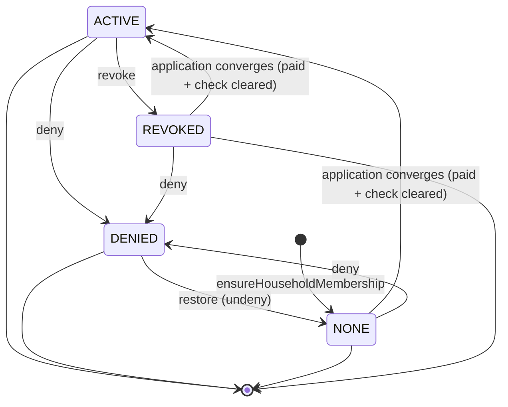

<!-- GENERATED — do not edit by hand.
     Source: the machine module’s exported TRANSITIONS, via src/lib/lifecycle/machineSpecs.ts.
     Regenerate: npm run generate:lifecycle-artifacts
     Drift-checked by src/lib/lifecycle/__tests__/artifactsDrift.test.ts. -->

# OrgMembership (household status) — lifecycle artifacts

Generated from the machine’s `TRANSITIONS`. Do not hand-edit.

## State diagram

## Coverage matrix (state × event → target)

A blank (`—`) cell is a **deliberate** absent edge — a decision to ratify, not an oversight.

| state ╲ event | application converges (paid + check cleared) | deny | ensureHouseholdMembership | restore (undeny) | revoke |
| --- | --- | --- | --- | --- | --- |
| ∅ | — | — | NONE | — | — |
| NONE | ACTIVE | DENIED | — | — | — |
| ACTIVE | — | DENIED | — | — | REVOKED |
| REVOKED | ACTIVE | DENIED | — | — | — |
| DENIED | — | — | — | NONE | — |

## Reachability

- **Initial:** NONE
- **Reachable (4):** ACTIVE, DENIED, NONE, REVOKED
- **Terminal (no outbound edge):** (none)
- **Accepting (designated resting states):** ACTIVE, DENIED, NONE, REVOKED
- **Dead-ends (reachable terminal, not accepting):** (none)
- **Unreachable (declared but no legal path from ∅):** (none)
