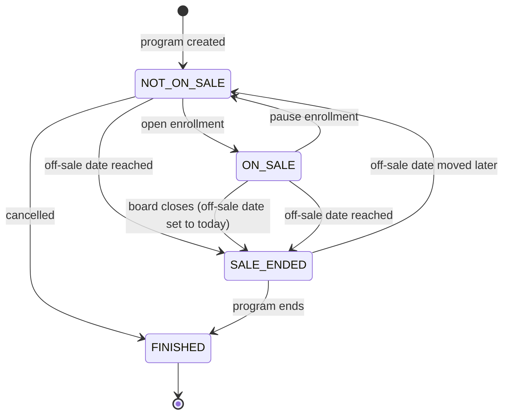

<!-- GENERATED — do not edit by hand.
     Source: the machine module’s exported TRANSITIONS, via src/lib/lifecycle/machineSpecs.ts.
     Regenerate: npm run generate:lifecycle-artifacts
     Drift-checked by src/lib/lifecycle/__tests__/artifactsDrift.test.ts. -->

# Program on sale — lifecycle artifacts

Generated from the machine’s `TRANSITIONS`. Do not hand-edit.

## State diagram

## Coverage matrix (state × event → target)

A blank (`—`) cell is a **deliberate** absent edge — a decision to ratify, not an oversight.

| state ╲ event | board closes (off-sale date set to today) | cancelled | off-sale date moved later | off-sale date reached | open enrollment | pause enrollment | program created | program ends |
| --- | --- | --- | --- | --- | --- | --- | --- | --- |
| ∅ | — | — | — | — | — | — | NOT_ON_SALE | — |
| NOT_ON_SALE | — | FINISHED | — | SALE_ENDED | ON_SALE | — | — | — |
| ON_SALE | SALE_ENDED | — | — | SALE_ENDED | — | NOT_ON_SALE | — | — |
| SALE_ENDED | — | — | NOT_ON_SALE | — | — | — | — | FINISHED |
| FINISHED | — | — | — | — | — | — | — | — |

## Reachability

- **Initial:** ∅
- **Reachable (5):** FINISHED, NOT_ON_SALE, ON_SALE, SALE_ENDED, ∅
- **Terminal (no outbound edge):** FINISHED
- **Accepting (designated resting states):** FINISHED
- **Dead-ends (reachable terminal, not accepting):** (none)
- **Unreachable (declared but no legal path from ∅):** (none)
