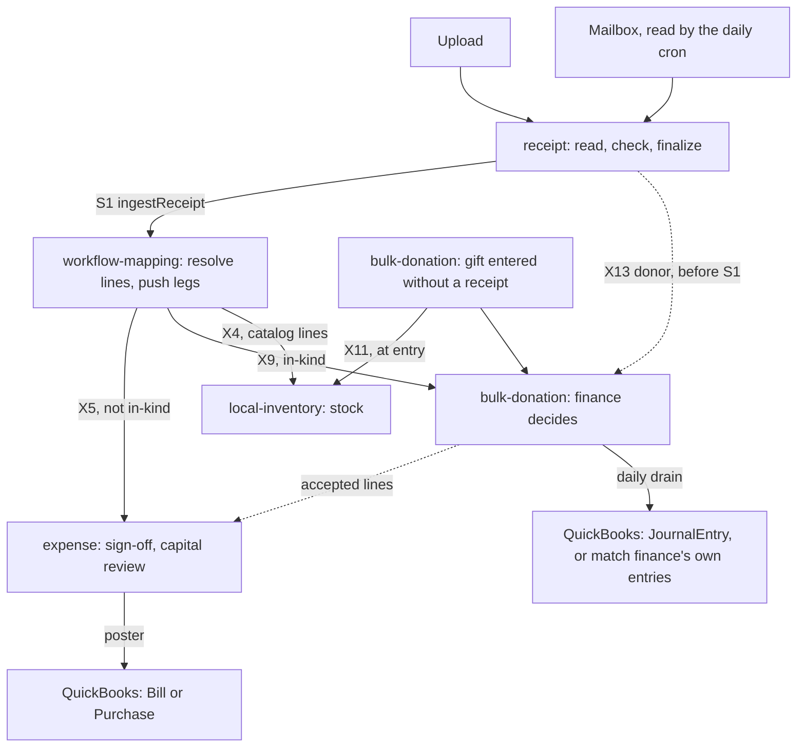

# Receipt pipeline

A receipt enters `@checkin/receipt` by upload or mail, and is read and checked until it is
finalized. `@checkin/workflow-mapping` then matches its lines to the catalog and sends it two
ways: goods to `@checkin/local-inventory`, and money to `@checkin/expense`, or to
`@checkin/bulk-donation` when the receipt records a gift of goods. Each money library runs its own
approvals and writes its own QuickBooks entry.

The libraries don't import each other. Each declares the ports it needs in its `contract.ts`, and
checkin binds those ports at boot in a `configure.ts` under `checkin-app/src/lib/`, so following
a receipt means reading a package, then the host file that connects it to the next one.

The one flag that decides the money path is the receipt's `isInKind`. The uploader sets it, at
upload or later while the receipt is open (`setInKind`); a mailed receipt starts without it.
Workflow-mapping reads it when it pushes, and nothing else chooses the route.

Paths below are relative to `packages/<library>/src/` and `checkin-app/src/`. S and X numbers are
the crossing names the code comments use.

| Step | Owner and file | Host connection | When it fails |
|---|---|---|---|
| Upload | receipt, `services/receiptService.ts` | `app/api/receipts/upload` | The upload answers once the file is saved, at `ocr_queued`. The reading runs after the answer in the same process, and the daily drain reads any receipt left queued; a receipt waiting more than 25 hours puts one line on the Problems list. The reading allowance is charged when the reading starts, so a saved upload over it lands in `ocr_failed`. OCR failure lands in `ocr_failed`, audited as `ocr_failed:<kind>`; the uploader presses "Read it again" or types the details. Every reading spends its call, whatever the failure. Three or more failed readings in a day put one line on the Problems list (`problemNotices`), which also sends the daily problems email. A process that dies mid-OCR is swept there. |
| Mail | receipt, `services/mailIntake.ts` | `receiptMailbox()` in `lib/receipt/configure.ts`; `takeInMailbox` runs from `app/api/cron/reconcile-shopify`, and the reading drain after it | Each new email is captured whole into the file store (90 days in prod, 30 in dev and staging), then processed from that copy; its receipts wait at `ocr_queued` for the drain. An email still unprocessed 25 hours after capture is a stuck "mail message" on the Problems list, whose Retry, the Board's only, replays it from the copy. Finance can replay one through `mail-messages/[id]/replay`; a replay's receipts wait for the next daily drain. An unverified sender or non-submitter is held for finance. A file over the daily limit is deferred to a later run. A mailbox that can't be listed sends no alert of its own: the run counts it as a failure, so the Problems list shows the job's latest run as failed and the daily problems email lists it. |
| Check and finalize | receipt, `lib/receipt-flow.ts`, `workflows/receipt.machine.ts` | None | Holds for the submitter or finance. An error, or a receipt stuck in `uploaded`, moves to `flow_error`, which finance can restart. A step that ran the flow after it committed, such as a confirmation, an approval, a resubmit or a reading, still answers as done, with the receipt in `flow_error`. |
| Deliver (S1) | receipt `pushReceipt`; workflow-mapping `services/receiptIntakeService.ts` | `receiptSink` in `lib/receipt/configure.ts` | Never throws; `pushedAt` stays null and the receipt is stuck, with its first failure time and latest error, until a person sends it again. A gift's unsent donor (X13) holds the push back, and sending again sends the donor first. Nothing resends by itself. |
| Resolve lines | workflow-mapping, `services/lineItemService.ts` | `catalogReader` in `lib/workflowMapping/configure.ts` | A failed catalog lookup of any kind leaves lines unrecognized and never fails the delivery. The receipt is saved in `pending_review` as "Matching pending", with `matchingPendingReason` (catalog unavailable, catalog settings error, or unexpected error) on its page and in its `matching_deferred` audit row. A person runs matching from the receipt or resolves the lines; the last one starts the push. |
| Push legs | workflow-mapping, `lib/apply-receipt.ts` | `expenseSink`, `donationSink`, `inventorySink` in `lib/workflowMapping/configure.ts` | A leg that succeeded is stamped and not resent. A failed leg gives `apply_failed`, stuck with its error and first failure time until a person retries it (`retry-apply`, or the Problems list) or closes it out as handled by hand (`close-out`, terminal `closed_by_hand`, never pushed again). A lost stamp or a push that throws leaves the receipt `applying`, stuck the same way. The daily sweep only pushes a receipt a crash left `applying` with no recorded failure. |
| Expense intake (X5) | expense, `services/intakeService.ts` | `expenseSink` | A malformed payload, another org's, or a replay that differs from a built expense is refused back to receiving. Once the payload is stored, expense owns it and receiving's leg is applied: any failure building the expense leaves the stored payload failed, stuck with its error and first failure time until a person retries it. The daily cron only finishes a payload a crash left unrecorded. Finance's queue and the Problems list show it while it is failed. |
| Inventory apply (X4) | local-inventory, `lib/services/receiptService.ts` | `inventorySink` | Stock is applied once per receipt or donation. A failed apply changes no stock and stays failed with its error and first failure time until a person retries it from the Problems list; a failed catalog event waits the same way. A pending provisional whose stored catalog decision fails to apply waits the same way, with the error on the provisional items page. The daily cron only reads catalog events not yet recorded, and applies stored decisions to pending provisionals that have no recorded failure and no failed event. |
| Gift intake (X9) | bulk-donation, `inKind.ts`, `services/inKindService.ts` | `donationSink` | Written once. A replay that differs is kept out and raised for finance. |
| Gift stock (X11) | bulk-donation, `services/manualInKindService.ts`; local-inventory, `lib/services/receiptService.ts` | `lib/bulkDonation/inventoryApply.ts` | A gift entered without a receipt sends its lines' GTINs and quantities under the key `donation:<id>`, and local-inventory applies them once per key. The gift is recorded first, and a failed load never undoes it. A failed load changes no stock and leaves a failed inventory delta, with its error and first failure time, on the Problems list as local inventory's "inventory delta" until a person retries it there or presses "Load again" on the gift's page, which shows the error. A delta refused before it is applied, such as one for another org, is not recorded; only the gift's page shows it unloaded. |
| Gift decision | bulk-donation, `services/inKindAcceptService.ts`, `services/inKindCapitalService.ts` | `capital` in `lib/bulkDonation/configure.ts`: expense's threshold test, review module and register | `waitingOn` names what is outstanding. Accepting a gift runs expense's capital threshold test inside the accept, so a failed test fails the accept and leaves the gift undecided. A gift over a threshold waits on `capital` until finance designates every line and sets each capital line's period on the gift's page, then on `register` until the in-kind drain has minted each capital line's assets and stamped the line. A failed registration records `capitalFirstFailedAt` and `capitalLastError`, and the gift is listed under gifts' stuck step "capital asset registration" until a later run or a retry from there registers it, which clears it. The register returns the same numbers for a line, so a crash between minting and stamping is safe. |
| Expense posting | expense, `lib/expense-qb-processor.ts`, `lib/expense-qb-poster.ts` | `quickbooks.posting` in `lib/expense/configure.ts`; `app/api/cron/qbo-posting` | No single account for a line gives `qb_on_hold`. A QuickBooks throttle (429) leaves the expense as it was; the run tries it once more, and a second throttle ends the run. Any other failed post waits on finance as `NEEDS_FINANCE` at once, stuck until finance or the Problems list retries it; the drain never retries it. An expense whose own data can't make an entry (no receipt date, no lines, a line with no resolved account) waits on finance as `NEEDS_FINANCE` at once, with no retries. So does an expense tried before when the app can't tell whether QuickBooks already holds its entry. A failure preparing the entry, before it reaches the outbox, moves the expense to `qb_error`, stuck with its first failure time and last error until finance or the Problems list retries it. |
| Gift posting | bulk-donation, `lib/in-kind-poster.ts` | `inKindQbPosting()` in `lib/bulkDonation/configure.ts`; `app/api/cron/qbo-posting` | The drain tries a gift again on its next run in two states only, while no failure is recorded: `NEEDS_ACCOUNT`, when a line has no usable account, and `POST_FAILED`, when the run couldn't read the books closing date and so tried no post. Everything else waits for finance, and the drain never takes it again. A QuickBooks throttle (429) puts the gift back in the state it had before the post (`POST_FAILED` if it had none); the run tries it once more, and a second throttle ends the run. Any other failed post leaves the gift `NEEDS_FINANCE`, stuck with `qbFirstFailedAt` and `qbLastError` until finance books it or the Problems list retries it; the drain moves on to the next gift. Accepting refuses a line that would book at $0, so a $0 line at the drain is a bug and fails as above. A gift the app won't book (no value, or no Class or in-kind income account in the books map) waits as `NEEDS_FINANCE` with no entry created. Before creating, the post looks up keyed entries in QuickBooks. It creates only when none could be this gift's, and settles as created when exactly one is cleanly its own; any other result (a key or amount/date mismatch, several candidates, an entry held by another gift) waits as `NEEDS_FINANCE`. `packages/quickbooks/src/match.ts` has the exact matching rules. On a retry, the same kind of lookup runs first over entries created since the first attempt, and also waits as `NEEDS_FINANCE` when the read fails other than by a throttle or fills a page. One dated in closed books, or one the run may not create, waits as `UNBOOKED`. |

Three things commonly mislead a reader. A set `pushedAt` means workflow-mapping accepted the
receipt, and the money may still have failed there as `apply_failed`. Expense state `qb_complete`
means the entry is queued in the outbox; `qbMatchState` says whether QuickBooks has it, and posting
starts both on the request that finishes sign-off and from the daily drain. An imported receipt
already in QuickBooks travels the same path with `backfill` set, and expense ends it at
`qb_skipped` without posting.

Boot order and the binding itself are in `checkin-app/src/instrumentation.ts`, which only binds and
touches no database. Reads also run backwards along this path: `lib/receipt/configure.ts` imports
expense, workflow-mapping and bulk-donation to show the uploader what became of the purchase
(`purchaseOutcomes`), the reimbursement's status, and its confirmations. The
injection seam is described in [COMPONENT_ARCHITECTURE.md](COMPONENT_ARCHITECTURE.md).

## Where to look when

- **A receipt hasn't reached finance.** Its state in `receipt.machine.ts`, and `validationNotes` on the receipt.
- **A finalized receipt isn't in workflow-mapping.** Its `lastError`, shown on its page, and its audit log: `push_failed` with the failure's kind, or `push_deferred` for a pending donor, whose `donor_sync_failed` rows say why it is still pending. An older receipt may also show `push_refused`, a refusal.
- **Workflow-mapping shows `apply_failed`.** `validationNotes` names the failed leg (Expense, Donation or Inventory).
- **Workflow-mapping shows `closed_by_hand`.** Its `receipt_closed_by_hand` audit row holds the note and, per leg, `applied`, `done_by_hand` or `not_needed`.
- **A signed expense isn't in QuickBooks.** The expense's `state` and `qbMatchState`; `lib/quickbooks/health.ts` lists what posting lacks.
- **A gift without a receipt isn't in stock.** Its page shows the load's error; the Problems list shows the failed inventory delta.
- **A gift isn't booking.** `waitingOn` in `inKindAcceptService.ts`.
- **A new port is needed between two libraries.** Declare it in the caller's `contract.ts`, then bind it in that caller's `configure.ts`.
