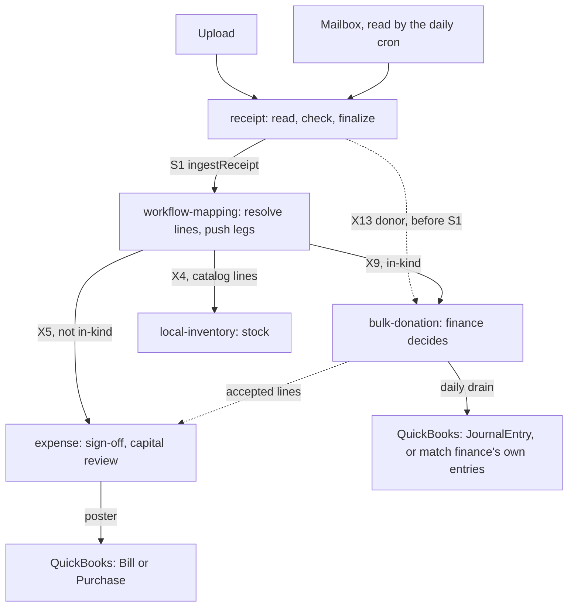

# Receipt pipeline

A receipt enters `@checkin/receipt` by upload or mail, and is read and checked until it is
finalized. `@checkin/workflow-mapping` then matches its lines to the catalog and sends it two
ways: goods to `@checkin/local-inventory`, and money to `@checkin/expense`, or to
`@checkin/bulk-donation` when the receipt records a gift of goods. Each money library runs its own
approvals and writes its own QuickBooks entry.

The libraries don't import each other. Each declares the ports it needs in its `contract.ts`, and
checkin binds those ports at boot in a `configure.ts` under `checkin-app/src/lib/`, so following
a receipt means reading a package, then the host file that connects it to the next one.

The one flag that decides the money path is the receipt's `isInKind`. The uploader sets it, at
upload or later while the receipt is open (`setInKind`); a mailed receipt starts without it.
Workflow-mapping reads it when it pushes, and nothing else chooses the route.

Paths below are relative to `packages/<library>/src/` and `checkin-app/src/`. S and X numbers are
the crossing names the code comments use.

| Step | Owner and file | Host connection | When it fails |
|---|---|---|---|
| Upload | receipt, `services/receiptService.ts` | `app/api/receipts/upload` | OCR failure lands in `ocr_failed`; the uploader retries or types the details. A process that dies mid-OCR is swept there. |
| Mail | receipt, `services/mailIntake.ts` | `receiptMailbox()` in `lib/receipt/configure.ts`; `readMailbox` runs from `app/api/cron/reconcile-shopify` | An unverified sender or non-submitter is held for finance. A file over the daily limit is deferred to a later run. |
| Check and finalize | receipt, `lib/receipt-flow.ts`, `workflows/receipt.machine.ts` | None | Holds for the submitter or finance. An error, or a receipt stuck in `uploaded`, moves to `flow_error`, which finance can restart. |
| Deliver (S1) | receipt `pushReceipt`; workflow-mapping `services/receiptIntakeService.ts` | `receiptSink` in `lib/receipt/configure.ts` | Never throws; `pushedAt` stays null. The daily cron resends until it gives up, then finance resends by hand. A gift's unsent donor (X13) holds the push back. |
| Resolve lines | workflow-mapping, `services/lineItemService.ts` | `catalogReader` in `lib/workflowMapping/configure.ts` | A failed catalog lookup leaves lines unrecognized. The receipt waits in `pending_review` until a person resolves them; the last one starts the push. |
| Push legs | workflow-mapping, `lib/apply-receipt.ts` | `expenseSink`, `donationSink`, `inventorySink` in `lib/workflowMapping/configure.ts` | A leg that succeeded is stamped and not resent. A failed leg gives `apply_failed`, which needs a person (`retry-apply`). A crashed push is swept, then gives `apply_failed`. |
| Expense intake (X5) | expense, `services/intakeService.ts` | `expenseSink` | The payload is stored first and the daily cron replays it. A replay that differs from a built expense is refused. |
| Gift intake (X9) | bulk-donation, `inKind.ts`, `services/inKindService.ts` | `donationSink` | Written once. A replay that differs is kept out and raised for finance. |
| Gift decision | bulk-donation, `services/inKindAcceptService.ts` | `capital` in `lib/bulkDonation/configure.ts` sends accepted lines to expense | `waitingOn` names what is outstanding. |
| Expense posting | expense, `lib/expense-qb-processor.ts`, `lib/expense-qb-poster.ts` | `quickbooks.posting` in `lib/expense/configure.ts`; `app/api/cron/qbo-posting` | No single account for a line gives `qb_on_hold`. A failed post retries on the drain, then waits on finance as `NEEDS_FINANCE`. |
| Gift posting | bulk-donation, `lib/in-kind-poster.ts` | `inKindQbPosting()` in `lib/bulkDonation/configure.ts`; `app/api/cron/qbo-posting` | `POST_FAILED` retries next run, up to `MAX_POST_ATTEMPTS`. Anything the drain can't settle goes to finance. A run stopped by its failure streak alerts finance. |

Three things commonly mislead a reader. A set `pushedAt` means workflow-mapping accepted the
receipt, and the money may still have failed there as `apply_failed`. Expense state `qb_complete`
means the entry is queued in the outbox; `qbMatchState` says whether QuickBooks has it, and posting
starts both on the request that finishes sign-off and from the daily drain. An imported receipt
already in QuickBooks travels the same path with `backfill` set, and expense ends it at
`qb_skipped` without posting.

Boot order and the binding itself are in `checkin-app/src/instrumentation.ts`, which only binds and
touches no database. Reads also run backwards along this path: `lib/receipt/configure.ts` imports
expense, workflow-mapping and bulk-donation to show the uploader what became of the purchase
(`purchaseOutcomes`), the reimbursement's status, and its confirmations. The rules these steps
enforce are in [expenses.md](../rules/expenses.md) and [revenue.md](../rules/revenue.md); the
injection seam is described in [COMPONENT_ARCHITECTURE.md](COMPONENT_ARCHITECTURE.md).

## Where to look when

- **A receipt hasn't reached finance.** Its state in `receipt.machine.ts`, and `validationNotes` on the receipt.
- **A finalized receipt isn't in workflow-mapping.** The receipt's audit log: `push_failed`, or `push_deferred` for a pending donor.
- **Workflow-mapping shows `apply_failed`.** `validationNotes` names the failed leg (Expense, Donation or Inventory).
- **A signed expense isn't in QuickBooks.** The expense's `state` and `qbMatchState`; `lib/quickbooks/health.ts` lists what posting lacks.
- **A gift isn't booking.** `waitingOn` in `inKindAcceptService.ts`.
- **A new port is needed between two libraries.** Declare it in the caller's `contract.ts`, then bind it in that caller's `configure.ts`.
