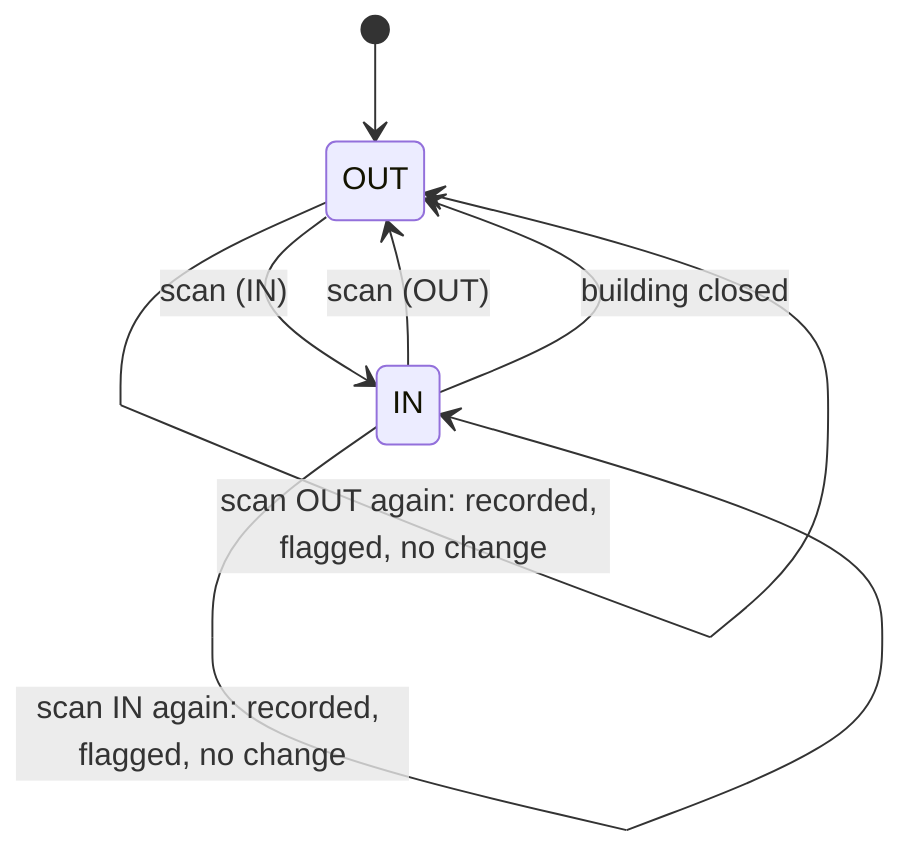
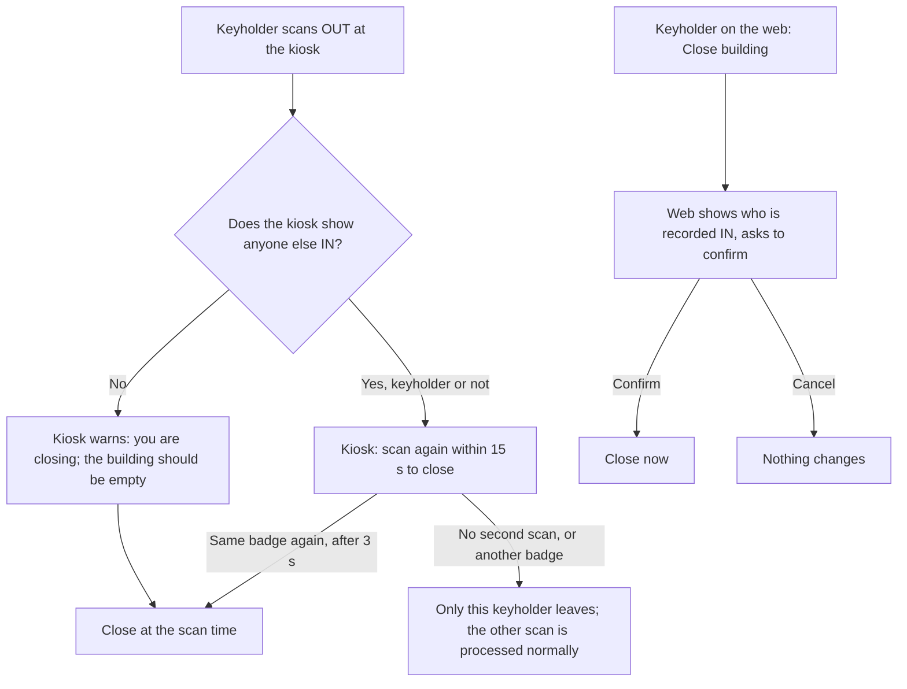

# Check-in state machine

The intended behaviour of check-in, check-out and closing the building.

**Source:** the Claude Doc "CheckMeIn check-in state machine"
(<https://claude.ai/code/artifact/ff104db1-f70e-4c60-97b0-5d75e8cd1ed1>),
assembled from the owner's rulings and signed off by the owner on 2026-10-11
and 2026-10-12; copied here 2026-10-12 from revision 12. That doc also lists
where the code differed at `main@1f2b2c826`; those gaps are tracked as work,
not here. Where this file and `docs/rules/attendance-checkin.md` disagree,
raise it with the owner.

## Principles

- **Trust people.** A scan means what the person meant by it.
- **The kiosk is the eyes in the building.** The keyholder at the kiosk decides
  whether the building is being closed. The server records that decision; it
  does not re-judge it.
- **Never lose a scan.** Every badge read is saved before anything else
  happens, and is eventually applied.
- **Apply, then review.** A late, out-of-order or odd scan is still applied, and
  is also flagged for a human. Nothing is held back instead of applied.
- **The web never claims more than it knows.** It shows building state only
  while it can hear from the kiosk.

## A person: IN or OUT

1. **A scan flips the person.** The kiosk shows the direction it is about to
   record, and that is what is recorded.
2. **Nothing blocks a check-in.** With no keyholder in, the person is still
   checked in; the visit is marked **no keyholder** unless a keyholder checks
   in within 10 minutes.
3. **A scan that doesn't fit** (IN while IN, OUT while OUT) is recorded and
   flagged; the person's state does not change.
4. **Repeat reads of the same badge within 3 seconds are one scan.** The kiosk
   filters them when the badge is read, before queueing or sending, so it works
   the same offline. The server only ignores exact duplicates (the same scan
   sent twice).
5. **Late scans** (queued offline) are applied in scan order, at scan time. A
   scan more than 10 minutes late, out of order, or with a suspect kiosk clock
   is applied **and** flagged.

## The building: open is derived, close is an event

- No stored open/closed switch. **Open** means at least one keyholder is IN.
- **Close** is the only building-level event: "keyholder K closed the building
  at time t". Everyone still IN becomes OUT with departure time t. The close is
  recorded (who, when, from where) as its audit trail.
- People still IN at a close are treated as forgotten badge-outs, not as people
  inside.

## Closing the building

Only a keyholder closes the building, at the kiosk or on the web. A board
member who needs to close it must be a keyholder.

1. **Kiosk, alone:** a keyholder's OUT when the kiosk shows nobody else IN
   closes the building on one scan, with the warning "You are closing the
   building. The building should be empty."
2. **Kiosk, others shown:** the kiosk lists who it thinks is in and asks for a
   second scan of the same badge within 15 seconds; that closes. No second
   scan, or any other badge scanning, means only the keyholder leaves (the
   other scan is processed normally). Applies whoever is shown, other
   keyholders included.
3. **Offline:** the same, using what the kiosk shows. The kiosk queues "close
   at t"; the server applies it whenever it arrives, with departures at t. A
   late close is not held for review.
4. **Web:** a keyholder confirms against the list of who is recorded IN; the
   close happens at that moment. Times are corrected afterwards on the visit
   edit screen.
5. **The server never second-guesses a close:** no comparison against its own
   records, no freshness window, no server-issued token.
6. **The web cannot stop a kiosk close.** No web action (checking the keyholder
   out, removing their visit, checking in another keyholder, changing roles)
   prevents or undoes a close confirmed at the kiosk, live or queued.
7. **Arrivals after a close** start a new visit. A close never departs a visit
   that began after its time t (allowing small clock skew).

## The kiosk

- **Saves every scan first,** then sends it; removes it from the queue only once
  the server has it. A restart never loses a scan.
- **Never blank:** shows the server's roster plus its own queued scans, and keeps
  showing that view offline.
- **Asks for the second scan itself.** The close confirmation happens at the
  kiosk, not the server.

## The web

- **With a recent kiosk heartbeat:** shows who is in, whether the building is
  open, and supervision state. No-keyholder visits are shown as such and never
  make the building look open.
- **Without one:** says it can't confirm building state ("kiosk last seen X
  ago") instead of showing occupancy, open/closed or supervision as fact.
